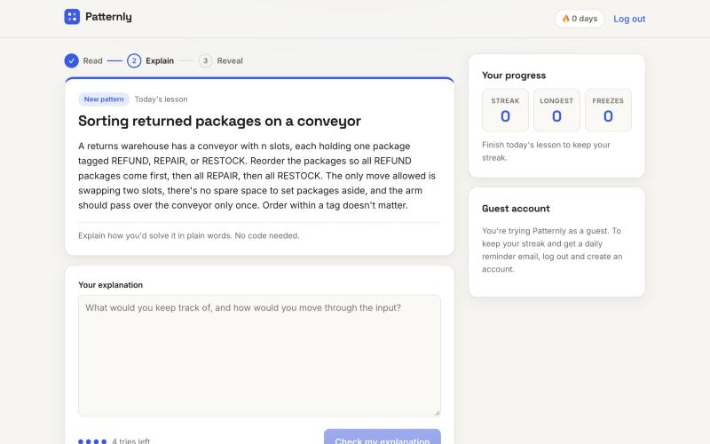

# Patternly

**Learn one algorithm pattern a day by explaining it in plain words.**

You read a short, everyday problem, like sorting returned packages on a conveyor or finding the first broken
nightly build. You explain how you'd solve it in your own words, with no code. A tutor built on the Claude API
tells you which key ideas you got and gives you a hint for what's missing, without giving the answer away. Once
you've got it, Patternly shows you the name of the pattern and a worked solution, then brings it back for review
a few days later.

### [Try it live →](https://d1gzfqnjgnrior.cloudfront.net)

Click **Try it as a guest** to do a lesson without signing up.



## How a lesson works

1. **Read a scenario.** A real-world problem with an algorithm pattern hidden inside. The pattern's name isn't
   mentioned.
2. **Explain your idea.** Describe your approach in plain words. You get up to four tries.
3. **Get feedback.** The tutor shows which key ideas you covered. If you're not there yet, you get a hint, and
   each hint is a bit stronger than the last: a nudge, then the shape of the approach, then a strong clue.
4. **See the pattern.** When you've got it (or after four tries), you see the pattern's name, a worked solution,
   and its cost. It comes back for review 5 to 7 days later, then at longer gaps.

You can keep a daily streak and get a reminder email at the hour you choose if you haven't done that day's lesson.

## What's interesting about it

- **The grading is measured, not assumed.** 60 sample learner answers were graded by hand, and 20 of them were
  set aside, unused until the tutor was finished. The tutor's grading is checked against those hand grades.
- **Hints are checked before you see them.** Every hint goes through a checker that blocks it if it names the
  pattern or gives away too much of the solution. Blocked hints get rewritten.
- **It doesn't nitpick.** A correct explanation passes even if it skips minor points like stating the running
  time. The core idea is always required.
- **The public demo can't run up a bill.** The tutor has a daily budget. Once it's used up, answers are graded
  by simple word matching until the next day, and the app says so.

## Results

Measured on the 20 held-out answers, three times each, after development was finished:

| What was measured | Result |
|---|---|
| How often the tutor's grading matched the hand grades, key idea by key idea | **94.1%** (92.9%, 95.5%, 93.8% across the 3 runs) |
| Wrong answers it passed by mistake | **0 of 13** in every run |
| Correct answers using a different approach that it accepted | **3 of 3** in every run |
| Hints that gave away the answer | **0 of 117** reached a learner; 2 drafts were caught and rewritten |

And from the live site and the development set:

| What was measured | Result |
|---|---|
| Time to grade an answer on the live site | 12.5 s typical, 19.0 s slowest (14 attempts from 2026-11-17 to 11-19, my own lessons and testing) |
| Cost to grade an answer on the live site | $0.024 on average |
| Finding the right pattern note for an answer (top 3 results) | 82.5% with hybrid search, 77.5% with vector search alone |

All the details, including how each number was measured, the runs behind it, and what didn't work, are in
**[docs/evaluation.md](docs/evaluation.md)**.

## Built with

- **Backend:** Python, FastAPI, PostgreSQL with pgvector, the Claude API
- **Frontend:** React and TypeScript (Vite)
- **Infrastructure:** Docker Compose, AWS (EC2, CloudFront, SES for email), GitHub Actions
- **Observability:** OpenTelemetry tracing for latency and cost per answer

## Challenges

**Knowing whether the grader is actually right.** A tutor that agrees with the hand grades is only as good as
those grades. During development, some hand grades turned out to be wrong and were fixed, which can quietly bias
them toward the tutor's opinion. Setting 20 answers aside from the start kept one honest check. It showed a real
gap: 94.1% agreement on the held-out answers, against 96.9% on the answers used during development. The most important
number, wrong answers passed by mistake, stayed at zero on both.

**Hints that help without spoiling the answer.** The tutor's hints were sometimes too good: 4 of its first 81
drafts named the pattern or said too much, even though its instructions forbid that. Instructions alone weren't
enough, so every hint now goes through a separate checker before a learner sees it. The checker is on the strict
side: it also flags some of the hand-written hints that should pass, which is still unresolved.

**Strict grading versus fair grading.** The first version failed any answer that left out a key point, so a
correct explanation that never mentioned the running time failed. The obvious fix, "pass if you get 4 of 6
points", looked fine until I tested it: it would have passed answers that hit the easy points but missed the
crucial insight, and failed valid alternative solutions. Instead, each point is marked core or minor, and only the
core ones are required.

**Ideas that didn't pay off.** I expected that giving the tutor reference notes about each pattern would make its
grading more accurate. When I measured it, there was no measurable change, and each answer cost 65% more to grade. Measuring first
saved building more on top of it.

**Reminders people can act on.** I first planned one reminder time for everyone. Working it out against my own
days, I realized the email would often arrive while I was in class or asleep, and by the time I saw it, it would
be buried. So each learner picks their own hour, in their own time zone.

**A public demo without an open-ended bill.** A link on a resume means anyone can use it, and every graded answer
costs money. Instead of hiding the app behind an invite code, the server tracks the tutor's spending each day and
switches to free word-matching grading past a daily budget. It also limits how many accounts one network can
create. The site keeps working either way and tells you which kind of grading you got.

More technical notes (time zones, email rendering, deployment, tracing) are in
[docs/how-it-works.md](docs/how-it-works.md#engineering-notes).

## Limits

- The 60 sample answers were written to cover different kinds of answers, not collected from real learners, and
  were graded by one person. 60 is a small set.
- The tutor's results vary a little from run to run.
- It hasn't been tested with real learners over time, so there's no evidence yet that the daily habit works for
  anyone.
- On the live demo, once the daily budget is used up, grading falls back to word matching, which is much weaker
  than the tutor.
- After the first tutor run, some hand grades on the development answers were corrected. That can bias them
  toward the tutor; the 20 held-out answers were never changed this way. Details in
  [docs/evaluation.md](docs/evaluation.md).

## Run it yourself

With Docker installed:

```
cp backend/.env.example backend/.env           # add ANTHROPIC_API_KEY and JWT_SECRET
docker compose --profile app up -d --build     # then open http://localhost:8080
```

No API key? Put `API_FLAGS=--offline` in `backend/.env` to grade by simple word matching instead.

Local development, the API endpoints, demo limits, tracing, and CI are covered in
[docs/how-it-works.md](docs/how-it-works.md). Deploying to AWS is in [deploy/README.md](deploy/README.md).

## What's where

| Folder | What's in it |
|---|---|
| [`content/`](content/) | The lessons: 15 patterns, 30 scenarios with their key ideas and hints, pattern notes, and the 60 graded sample answers |
| [`backend/`](backend/) | The Python API, the tutor, the hint checker, the learning schedule, and the evaluation tools |
| [`frontend/`](frontend/) | The React web app |
| [`evals/runs/`](evals/runs/) | Saved results from every evaluation run |
| [`deploy/`](deploy/) | The AWS setup |
| [`docs/`](docs/) | [Evaluation details](docs/evaluation.md), [how it works](docs/how-it-works.md), and the [original project plan](docs/project-plan.md) |
